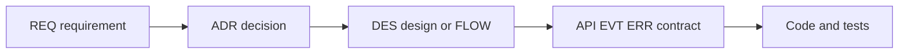

# Identity service

Documentation for this repository: context, requirements, decisions, architecture, design, contracts, engineering, and operations.

Service behavior is not designed yet. This tree is where that design will be written, and where every other durable fact about the project lives. An **accepted** document is the source of truth. Code follows it.

## Map

Read top to bottom the first time. After that, use the index in each folder or the [traceability table](09-quality/traceability.md).

| | Folder | Question it answers |
| --- | --- | --- |
| 00 | [Handbook](00-handbook/README.md) | How to read, write, and trace these docs |
| 01 | [Context](01-context/README.md) | What this project is, and the words we use |
| 02 | [Requirements](02-requirements/README.md) | What the service must do, and how we will know |
| 03 | [Decisions](03-decisions/README.md) | Choices that are expensive to reverse, and why |
| 04 | [Architecture](04-architecture/README.md) | Shape of the system: boundaries, dependencies, deployment |
| 05 | [Design](05-design/README.md) | How a part works: domain, security, data, flows |
| 06 | [Contracts](06-contracts/README.md) | What callers and other modules can rely on |
| 07 | [Engineering](07-engineering/README.md) | How to build, change, and test the code |
| 08 | [Operations](08-operations/README.md) | How to configure, run, and recover the service |
| 09 | [Quality](09-quality/README.md) | Traceability, open questions |
| 10 | [Records](10-records/README.md) | Spikes and notes. Not a source of truth |

Numbers are a stable reading order. Do not renumber a folder after it exists. Add a new area at the end.

## Trace a change

A need becomes a requirement. A hard choice becomes a decision. The workings become a design or a flow. The external shape becomes a contract. Code proves it.

A wording fix does not need a new decision. A new external behavior needs a requirement and a contract. A choice that is expensive to reverse needs a decision.

Rules and ID prefixes: [conventions](00-handbook/conventions.md). Which path to open for a job: [reading paths](00-handbook/reading-paths.md).

## What is true today

Repository facts, separate from design: [overview](01-context/overview.md).

`HELP.md` at the repository root is Spring Initializr output. It is gitignored and is not part of this documentation.
